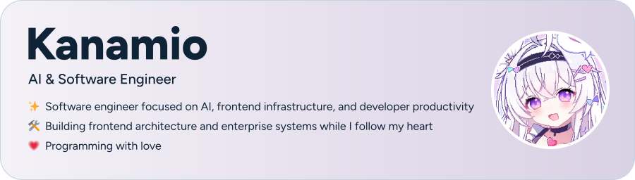

<!-- Generated with `just generate`. -->

  <picture><source media="(max-width: 640px)" srcset="assets/hero-mobile.svg"></picture> 
  <a href="https://kanamio.dev/" target="_blank" rel="noopener noreferrer" referrerpolicy="no-referrer"><picture><source media="(max-width: 384px)" srcset="assets/btn-website-stacked.svg"><source media="(max-width: 640px)" srcset="assets/btn-website-mobile.svg"></picture></a>&#8203;<a href="https://x.com/kanamiox" target="_blank" rel="noopener noreferrer" referrerpolicy="no-referrer"><picture><source media="(max-width: 384px)" srcset="assets/btn-x-stacked.svg"><source media="(max-width: 640px)" srcset="assets/btn-x-mobile.svg"></picture></a>

